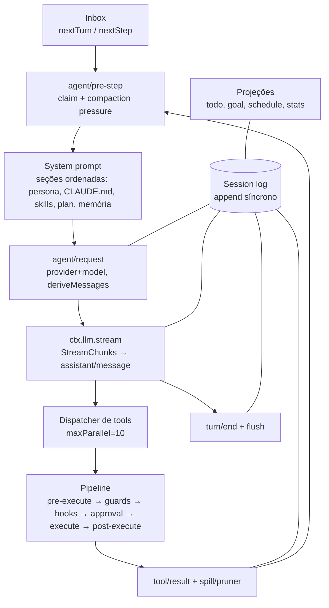
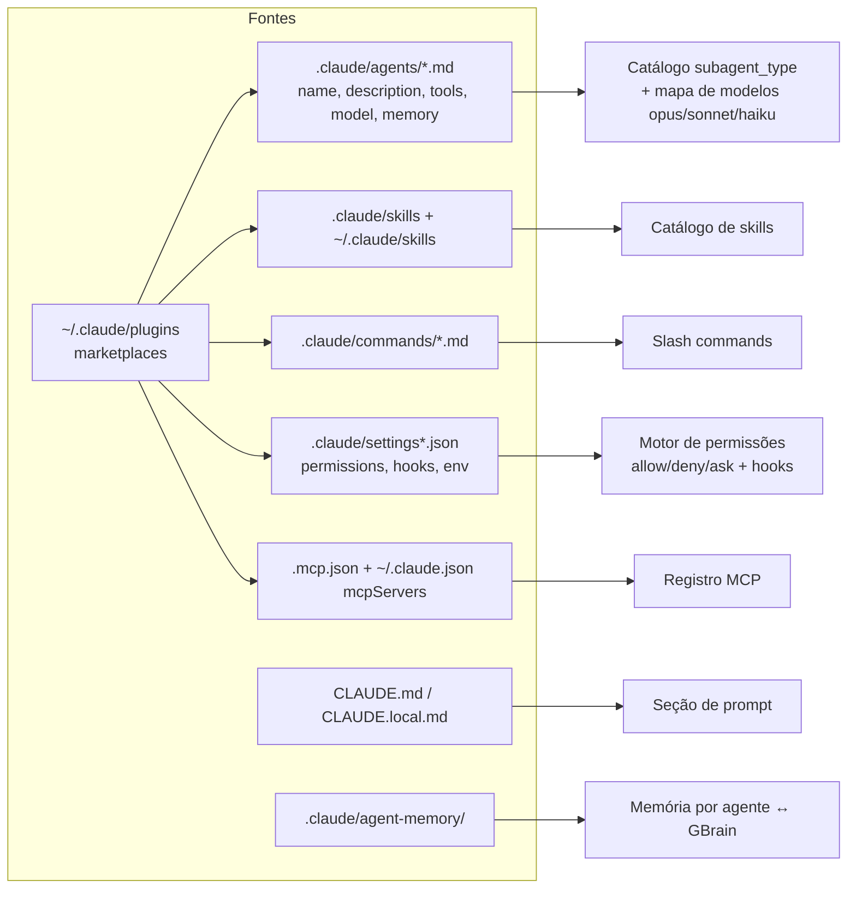

# C4 — Nível 3: Componentes (containers críticos)

## 1. Agent plane (`core`) — hoje e alvo 🟢

## 2. LLM runtime 🟢 → 🟡
| Componente | Hoje (dsh) | Alvo (Rust) |
|---|---|---|
| Registro de adapters | `registerAdapter(providers)`, um dono por provider | Igual (`HashMap<ProviderId, Arc<dyn LlmAdapter>>`) |
| Protocolos | openai-completions, openai-responses, anthropic-messages | + **gemini generateContent** (nativo) |
| Catálogo | 39 provedores / 113 modelos de custo zero (pi-ai) | Catálogo próprio atualizável (`models.dev`/OpenRouter API) + manual |
| Auth | API key (YAML) + OAuth (Claude, ChatGPT, Copilot, xAI, Kimi, OpenRouter) | Cofre do SO + OAuth **Google (Gemini Pro)** + os demais |
| Retry | 5×, 500 ms–10 s, jitter de 10% | Igual + **cadeia de fallback** por workspace |
| Política de dados | — | `data_policy` por provedor + `allowed_providers` por workspace |
| Medição | chars/4 | tokenizer por família (tiktoken-rs) quando disponível |

## 3. Compatibilidade Claude Code (`harness-claude-compat`) 🟡

## 4. Integrações gerenciadas (`harness-integrations`) 🟡
| Integração | Pré-requisito | Instalação/atualização | Registro |
|---|---|---|---|
| REA | Node ≥ 22.23 | `npm i -g rea-agents` / `rea update` | `rea` → `node …/scripts/rea.mjs mcp` |
| GBrain | Bun ≥ 1.4.4 | `bun install -g github:garrytan/gbrain#latest-stable` | `gbrain serve --surface starter` |
| Playwright MCP | Node | npm `@playwright/mcp` | stdio |
| Chrome DevTools MCP | Node + Chrome | npm `chrome-devtools-mcp` | stdio |
| Computer use | Cua Driver | conforme upstream | MCP |
| csharp-ls | .NET SDK (detectado) | `dotnet tool install/update -g csharp-ls` | LSP |
| Gemini CLI (opcional) | Node | npm `@google/gemini-cli` | agente ACP |
