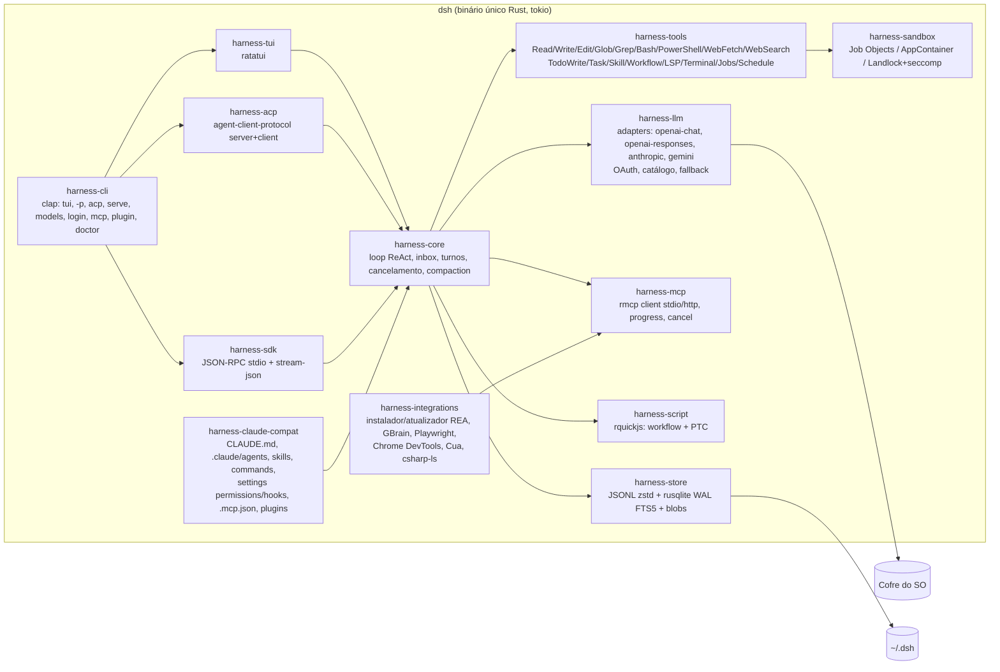

# C4 — Nível 2: Containers

## 1. Como é hoje (dsh) 🟢
```mermaid
flowchart LR
  subgraph Host["Processo Node (dsh --profile …)"]
    LAUNCH[Launcher apps/cli\nperfis, patches, sinais]
    LOADER[Loader cordis\nDI + fibers + HMR]
    CORE[Agent plane\nagent-loop, tools, prompt, compaction]
    LLMR[LLM runtime\npi-ai + deepseek adapters + retry]
    EXEC[Execução\nsubprocess, sandbox, bash/pwsh, PTC Node]
    EXT[Extensibilidade\nskills, subagents, hooks*, mcp*, workflow]
    PERS[Persistência\nsession JSONL zstd, storage, spill, attachments]
    SURF[Superfícies\nwebserver+gateway | ACP | SDK JSON-RPC | headless]
  end
  WEBUI[Cliente web React\nslots/UI cordis]
  FILES[(~/.dsh\nsessions, settings.yaml,\n.credentials.yaml, storages)]
  LAUNCH --> LOADER --> CORE
  CORE --> LLMR
  CORE --> EXEC
  CORE --> EXT
  CORE --> PERS --> FILES
  SURF --> CORE
  WEBUI <-- "HTTP + WS (token)" --> SURF
```
`*` hooks e mcp-client existem, mas **não** vêm montados no bundle `base`.

## 2. Alvo (harness Rust): workspace Cargo 🟡

