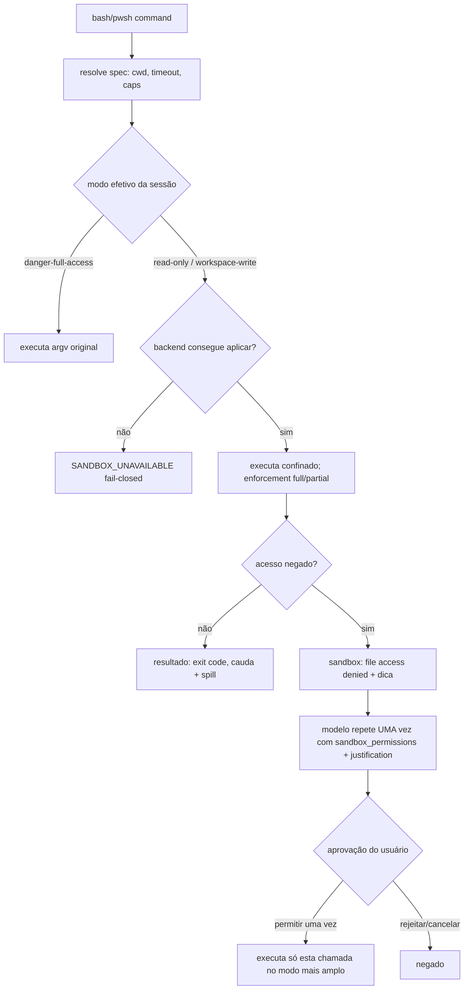
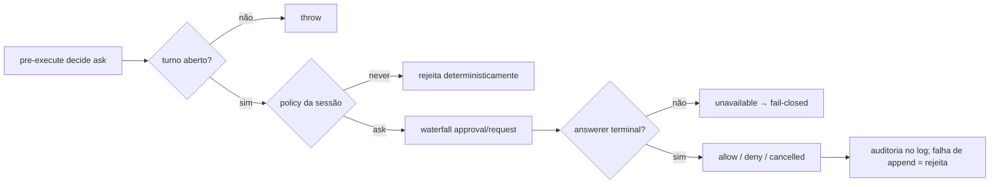
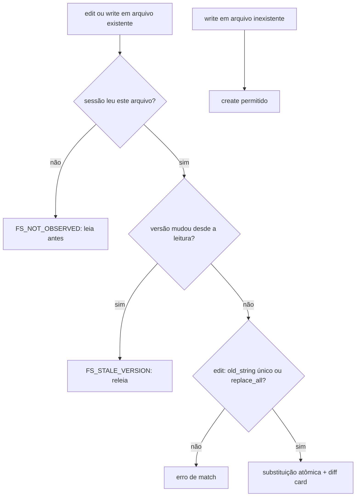

# Fluxogramas — `sandbox`, `interaction`, `shell`, `fs`

## 1. Chamada de shell confinada com escalonamento 🟢

## 2. Aprovação (`user-approval`) 🟢

## 3. Edição guardada por observação (`fs-observation-policy`) 🟢

