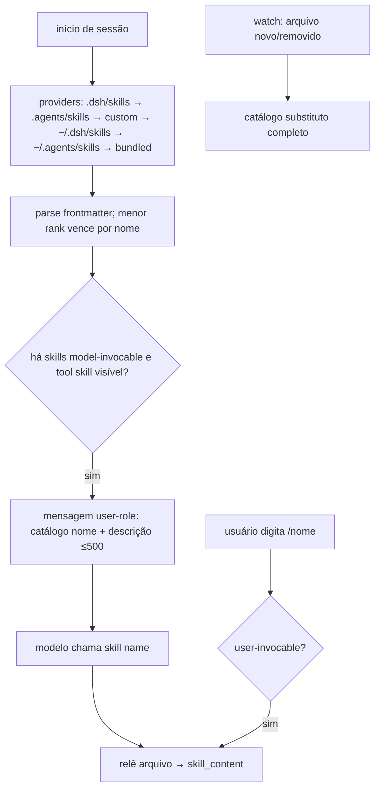
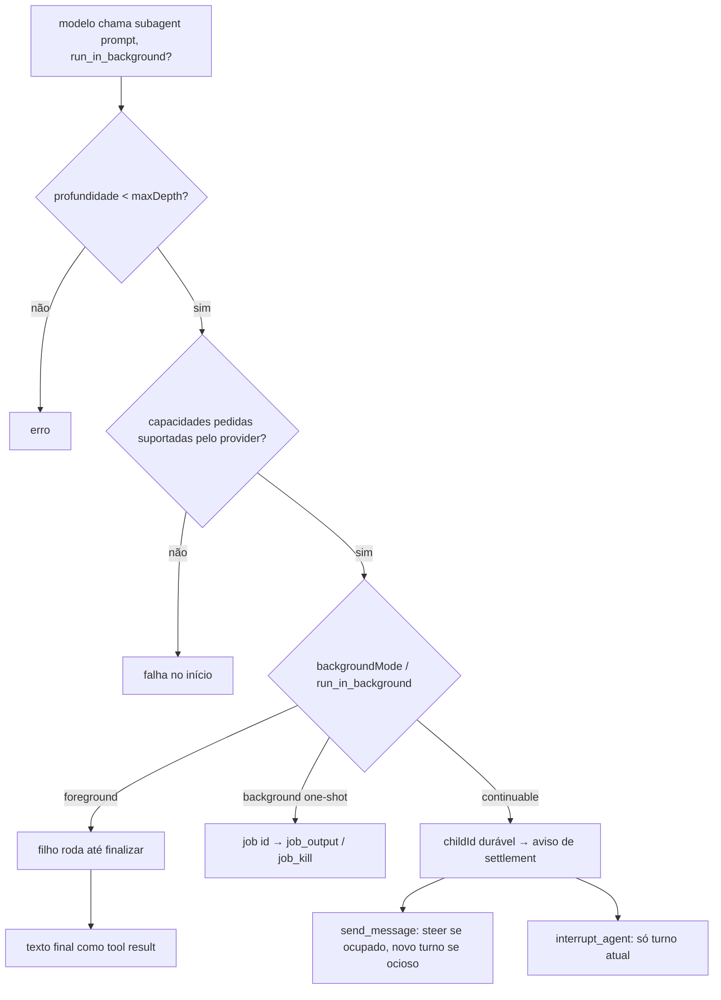
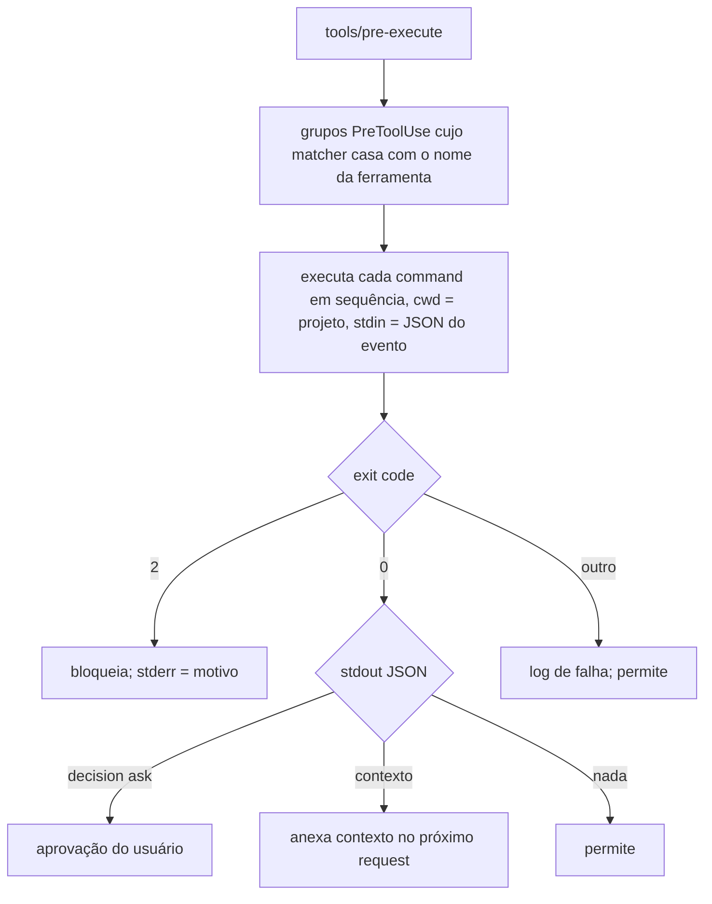
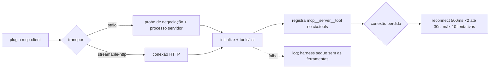

# Fluxogramas — `skill`, `subagent`, `hooks`, `mcp`

## 1. Skills: descoberta e uso 🟢

## 2. Delegação a subagente 🟢

## 3. Hook PreToolUse (bridge Claude Code) 🟢

## 4. Ciclo de vida do servidor MCP 🟢

