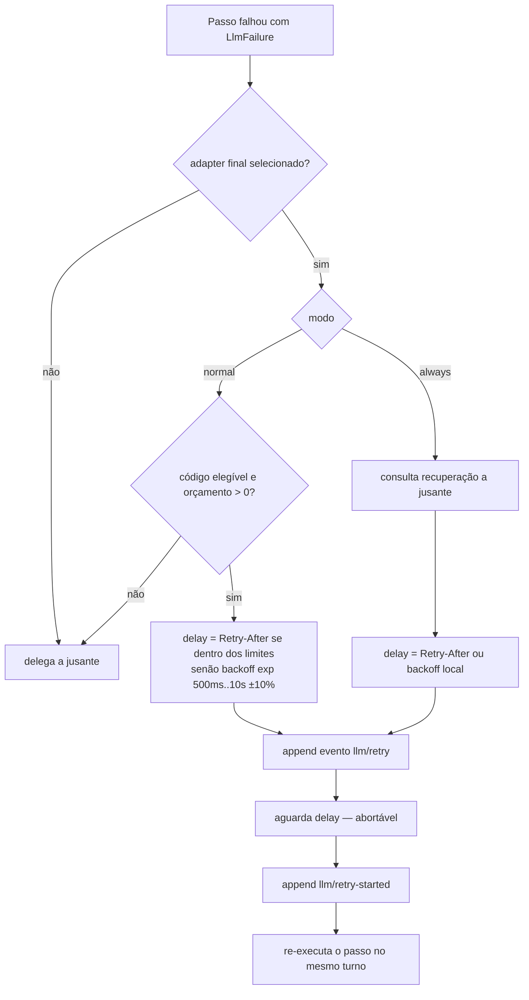
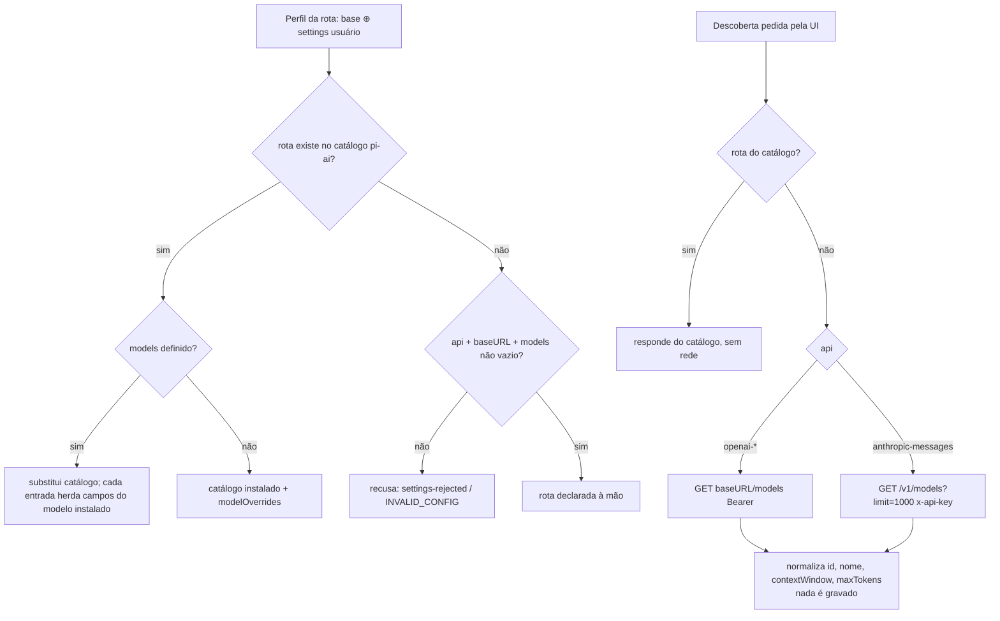

# Fluxogramas — módulo `llm`

## 1. Chamada de modelo (`ctx.llm.stream`) 🟢

```mermaid
flowchart TD
  A[GenerateOptions<br/>provider, model, messages, tools] --> B{Rota registrada?}
  B -- não --> F1[finish error NO_ADAPTER]
  B -- sim --> C[resolveModelInfo<br/>contexto, efforts, modalidades]
  C --> D{reasoningEffort válido?}
  D -- não --> F2[falha antes de I/O]
  D -- sim --> E[materializa defaults do adapter<br/>maxTokens etc. + deep-freeze]
  E --> G[prepareCall: liga à geração exata do adapter]
  G --> H[projeção de conteúdo]
  H --> H1[FileBlock → texto com caminho read-only]
  H --> H2{modelo aceita imagem?}
  H2 -- não --> H3[placeholder determinístico]
  H2 -- sim --> H4{dentro do orçamento de imagem?}
  H4 -- não --> F3[finish error IMAGE_OFFLOAD_REQUIRED n]
  H4 -- sim --> I
  H3 --> I[waterfall llm/stream → adapter]
  H1 --> I
  I --> J[chunks: block-start / deltas / block-end]
  J --> K[usage]
  K --> L[finish stop | tool-calls | max-tokens | error | aborted]
```

## 2. Retry (`llm-retry`, ponto de extensão failed-step) 🟢



## 3. Resolução de catálogo e descoberta (`llm-pi-ai`) 🟢


