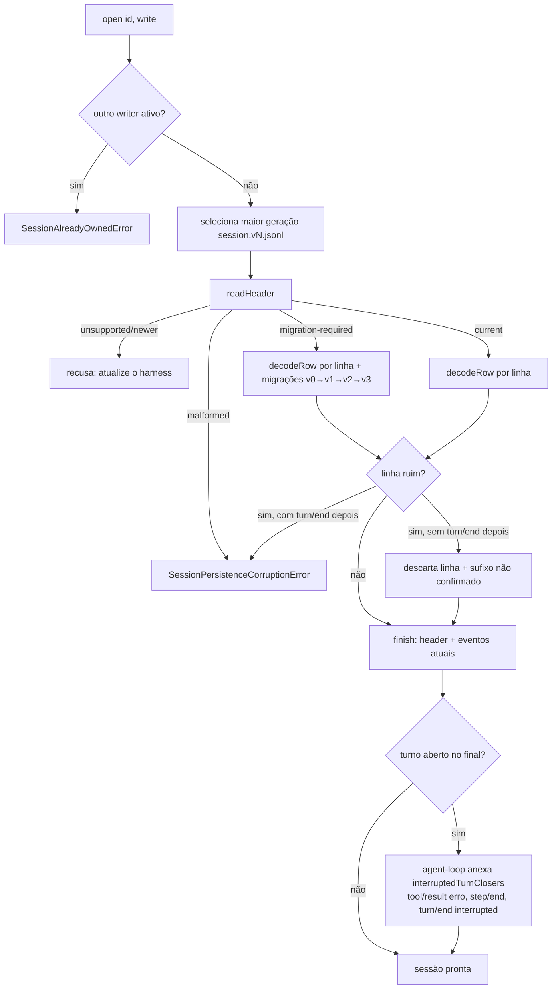
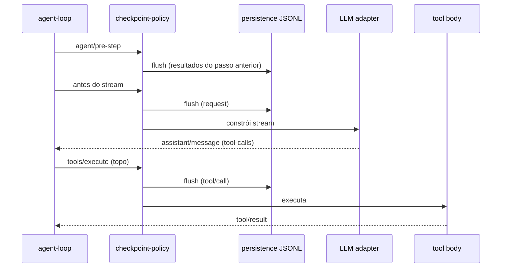
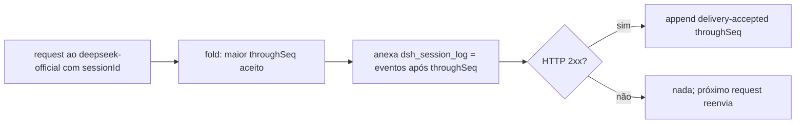

# Fluxogramas — módulo `session`

## 1. Abertura e restauração de sessão (JSONL + catálogo de formato) 🟢

## 2. Barreiras de checkpoint 🟢

## 3. Envio do log à DeepSeek (`session-log-deepseek`, ligado por padrão) 🟢

