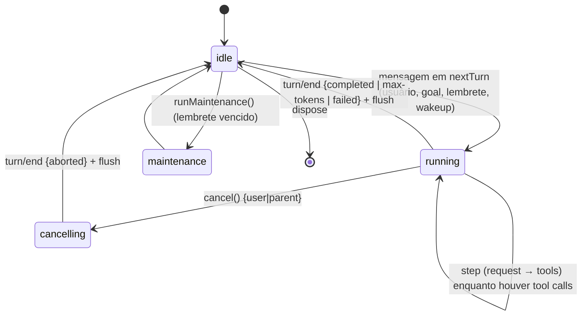
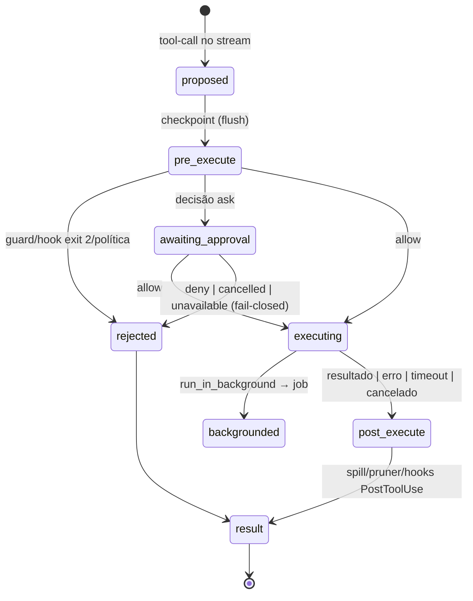
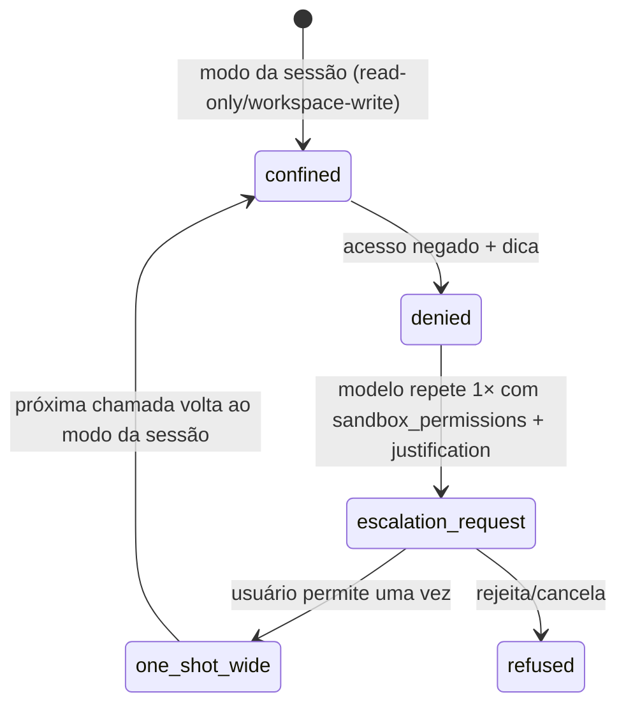
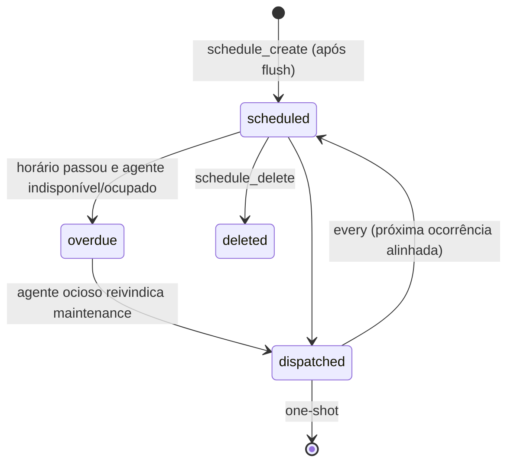

# Máquinas de estado

## 1. Agente / turno 🟢

Regras: a cancelação antes do claim limpa as filas. Um observer de notificação não pode vetar a parada. Depois de `turn/end`, a cancelação não afeta o trabalho já concluído.

## 2. Chamada de ferramenta 🟢

## 3. Aprovação 🟢
`pending → allow | deny | cancelled | unavailable`. Com policy `never`, a rejeição é determinística. Uma falha de append da auditoria vira rejeição.

## 4. Escalonamento de sandbox 🟢

## 5. Goal 🟢

```mermaid
stateDiagram-v2
  [*] --> active: create_goal
  active --> paused: update_goal/usuário
  paused --> active: retomada
  active --> blocked: relatório blocked
  blocked --> active: retomada humana
  active --> complete: relatório complete
  note right of active: armado/desarmado é flag local; resume/fork ⇒ desarmado
```

O driver de rodadas atua só em `active` + armado + agente ocioso + rodadas restantes (≤ 256). Para em max-tokens, falha de durabilidade, cancelamento ou unload.

## 6. Job 🟢
`running → stopping → settled {completed|failed|killed}`. Aviso de conclusão: `pending → delivered (wakeup | injeção no próximo step)`. Avisos pendentes morrem com o dono.

## 7. Lembrete (schedule) 🟢

## 8. Servidor MCP 🟢
`connecting → initialized (tools/list registradas) → lost → reconnecting (500 ms ×2 até 30 s, máx. 10) → initialized | failed`. A falha inicial não derruba o harness.

## 9. Handle de persistência 🟢
`open(write) → writing → flushing → writing … → closed`. Possíveis desvios: `ownership-lost` e `corruption` (terminais). Leitura do header: `current | migration-required | unsupported | malformed`.

## 10. Execução de pacote cordis dinâmico 🟢
`defined → host-running → awaiting-browser-approval → loaded | declined | failed(stage)` → `stopped` → `undefined`.
